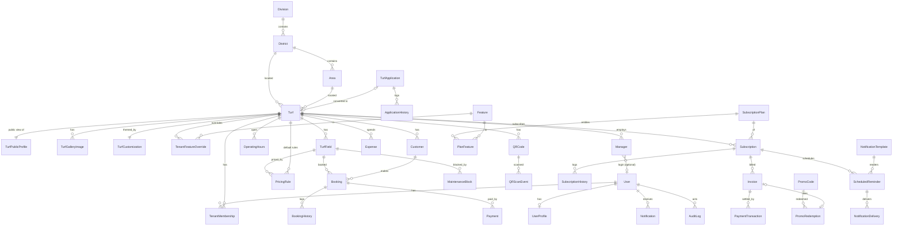

# TURFOS — Architecture, Data Model, Security & Roadmap (Phase 1)

Status: **Phase 1 deliverable — proposal for review.** No application code exists yet.
Date: 2026-11-18

---

## 0. Repository inspection result

`G:\new all project\TURF` is **empty** (no files, not a git repo). This is a greenfield build; there is no existing code to preserve.

Local toolchain found:

| Tool | Status |
|---|---|
| Python | 3.13.14 ✅ |
| Node / npm | 26.13.1 / 11.20.0 ✅ |
| git | 2.56 ✅ |
| MySQL | ❌ not installed (needs MySQL 8 server) |
| Redis | ❌ not installed |
| Docker | ❌ not installed |

> **Change 2026-11-18:** by owner decision the database is **MySQL 8 (InnoDB, utf8mb4)** instead of PostgreSQL. PostgreSQL-only features (exclusion constraints, `pg_trgm`, `citext`, array fields, row-level security) are replaced with MySQL-compatible designs below. Redis is needed for Celery from Phase 16; until then the cache falls back to in-process memory locally.

---

## 1. Repository layout

```
TURF/
├── backend/                     Django 5.2 + DRF
│   ├── config/                  settings/{base,dev,prod,test}.py, urls, celery.py, asgi/wsgi
│   ├── apps/
│   │   ├── common/              base models (UUID, timestamps), money, tenancy mixins, permissions, throttles
│   │   ├── accounts/            User, UserProfile, unified login, password reset, MFA (TOTP, super admin)
│   │   ├── tenants/             Turf (tenant), TenantMembership, Role/Permission
│   │   ├── applications/        TurfApplication, ApplicationHistory, conversion service
│   │   ├── locations/           Division, District, Area (+ BD seed fixtures)
│   │   ├── public_listings/     TurfPublicProfile, TurfGalleryImage, Amenity, discovery API
│   │   ├── customization/       TurfCustomization / theme tokens, presets
│   │   ├── fields/              TurfField
│   │   ├── operating_hours/     OperatingHours, special closures
│   │   ├── pricing/             PricingRule, SpecialDatePrice, quote engine
│   │   ├── bookings/            Booking, BookingHistory, MaintenanceBlock, availability service
│   │   ├── customers/           Customer (tenant-scoped)
│   │   ├── managers/            Manager profile + permissions
│   │   ├── payments/            Payment (booking money)
│   │   ├── subscriptions/       SubscriptionPlan, Subscription, SubscriptionHistory, Invoice, PaymentTransaction, Feature entitlements
│   │   ├── promotions/          PromoCode, PromoRedemption
│   │   ├── qr_booking/          QRCode, QRScanEvent, public booking request API
│   │   ├── notifications/       Notification, NotificationDelivery, ScheduledReminder, Celery tasks
│   │   ├── email_templates/     NotificationTemplate (editable, previewable)
│   │   ├── expenses/            Expense
│   │   ├── reports/             read-only query services + PDF/Excel exporters
│   │   ├── audit_logs/          AuditLog + middleware/service
│   │   └── website_content/     WebsiteContent, FAQ, PlatformSettings
│   └── tests/                   cross-app isolation & security suites
├── frontend/                    Vite + React 19 + TS + Tailwind 4 + shadcn/ui
│   └── src/
│       ├── app/                 router, providers, query client
│       ├── lib/                 api client (CSRF-aware fetch), zod schemas, formatters (BDT, Asia/Dhaka)
│       ├── components/ui/       shadcn primitives
│       ├── features/
│       │   ├── public/          home, explore, turf details, booking, register-your-turf
│       │   ├── auth/            unified login, reset password
│       │   ├── admin/           super admin dashboard & modules
│       │   └── workspace/       owner/manager dashboard & modules
│       └── theme/               design tokens, tenant theme provider
├── docker-compose.yml           mysql, redis, mailpit (optional), (backend, worker, beat, frontend in full mode)
├── docs/                        architecture, API, deployment, security, PDF guide sources
└── .env.example
```

**Why a single SPA + Django API on one origin:** Django session auth + CSRF works cleanly when the SPA and `/api/` share an origin (Vite dev proxy locally, Nginx in production). This avoids storing JWTs in the browser and keeps CSRF protection native.

---

## 2. Key architectural decisions

| Area | Decision | Reason |
|---|---|---|
| Multi-tenancy | **Shared database, shared schema, `turf_id` FK on every tenant-owned row.** Tenant resolved server-side from `TenantMembership`, never from the request body. | Public discovery must query across tenants efficiently; schema-per-tenant (django-tenants) makes that and reporting awkward. |
| Tenant enforcement | `TenantScopedModel` base + `TenantQuerySet.for_tenant()`; DRF `TenantViewSet` base whose `get_queryset()` always filters by `request.tenant`; object lookups go through the scoped queryset (→ 404, not 403, on other tenants' IDs). MySQL has no row-level security, so isolation is enforced in the app layer and proven by an automated test that hits every workspace route with another tenant's IDs. | Defense in depth against IDOR. |
| Auth | Django sessions, `HttpOnly`/`Secure`/`SameSite=Lax` cookies, CSRF token endpoint, Argon2 password hasher, DRF throttles + `django-axes` for login lockout, TOTP MFA for super admin (`django-otp`). | Server-side truth for role & tenant. |
| Roles | `User.is_platform_admin` for Super Admin; `TenantMembership(role=OWNER|MANAGER, permissions=…)` for workspace users. Login response returns the redirect target computed server-side. | No role picker; no client-supplied role. |
| Booking overlap | One code path (`bookings.services.reserve_slot`) for every booking create/reschedule: `transaction.atomic()` → `SELECT … FOR UPDATE` on the `TurfField` row (serialises all writers for that field in InnoDB) → overlap query `start < new_end AND end > new_start AND status IN (pending, confirmed)` plus the same check against `MaintenanceBlock` → insert. Composite index `(field_id, start, end)`. A threaded concurrency test against real MySQL proves two simultaneous requests cannot both succeed. | MySQL has no exclusion constraints; row locking gives the same guarantee. |
| Money | `DecimalField(max_digits=12, decimal_places=2)`, BDT only, `Decimal` arithmetic with `ROUND_HALF_UP`. | No floats. |
| Time | `TIME_ZONE="Asia/Dhaka"`, `USE_TZ=True`; bookings stored as aware datetimes. Overnight slots (e.g. 11 PM–1 AM) supported because ranges are datetimes, not date+time pairs. | Turfs often run past midnight. |
| Pricing | Rules evaluated per minute-segment; quote splits a booking across rule boundaries; result stored as JSON `price_snapshot` + totals on the booking. Priority: special date > holiday > weekday/weekend time band > field default. | Required price-period splitting & historical immutability. |
| Search | MySQL `FULLTEXT` index (ngram parser, works for short Bangla/English tokens) on name/address/area text, with `icontains` fallback for 1–2 character queries; B-tree indexes on district/area/type/listing status; denormalised `min_public_price` on public profile, recomputed on pricing change. | Fast filtered discovery with pagination. |
| Public data | Separate **public serializers** with explicit field whitelists; public endpoints only read through `TurfPublicProfile.objects.publicly_listed()`. Tests assert response keys exactly. | Prevents private data leakage. |
| Slugs/QR | Public URLs use `slug` (`/turfs/<slug>`) and QR uses `/b/<token>` where token = `secrets.token_urlsafe(24)`; revoked tokens kept with `revoked_at` and return 410. | No internal IDs exposed; revocable. |
| QR / PDF / Excel | `segno` (QR PNG/SVG), `reportlab` (receipts, QR print sheet, report PDFs), `openpyxl` (Excel). | Pure-Python, Windows-friendly (WeasyPrint needs GTK). |
| Images | Pillow verify + re-encode to WebP, max size/dimension limits, randomized filenames, EXIF stripped; `django-storages` S3-compatible (Cloudflare R2 / DO Spaces) in prod, local `MEDIA_ROOT` in dev. | Safe uploads. |
| Background jobs | Celery + Redis broker; Celery Beat runs `dispatch_due_reminders` every 15 min, `expire_subscriptions` hourly, `release_stale_pending_bookings` every 10 min. | Required stack. |
| Reminders | `ScheduledReminder` rows created when a subscription becomes active: unique `(subscription, days_before, channel)`; dispatcher locks with `select_for_update(skip_locked=True)`, marks sent, writes `NotificationDelivery`. Renewal → old subscription's pending reminders set `cancelled`. Dispatcher also re-checks the subscription is still current before sending. | Idempotent, no duplicates, no stale sends. |
| Features | `Feature` catalog → `PlanFeature` (plan entitlements) → `TenantFeatureOverride` (super admin on/off). `has_feature(turf, code)` cached per request; DRF permission `RequiresFeature("excel_exports")`. Frontend reads `/api/workspace/me` feature list only to hide UI. | Backend enforcement. |
| Subscription gating | `SubscriptionGate` permission: expired/suspended tenants get read-only access to history + renewal page; writes (new bookings, etc.) return 402/403 with a clear code. Public listing & public booking check eligibility on every request. | Matches policy requirement. |
| Payments | Manual payment record → `pending_verification` → super admin verifies → subscription activated. Gateway adapter interface (`PaymentGateway.initiate/verify/handle_ipn`) with stub for SSLCommerz/bKash/Nagad; IPN verification server-to-server + idempotency key on `PaymentTransaction`. | Never trust frontend success. |
| API docs | `drf-spectacular` → `/api/schema/`, `/api/docs/` (admin-only in prod). Frontend types generated from the OpenAPI schema (`openapi-typescript`). | Single source of API truth. |
| Anti-spam (public) | DRF scoped throttles per IP + per phone, honeypot field, minimum form-fill time, optional Cloudflare Turnstile (keys via env). Pending public requests limited per phone per turf per day. | Public booking without login. |

### Assumptions (documented, adjustable later)

1. **Pending public booking requests hold the slot** (so two teams can't both be "pending" for the same time), and auto-expire if not confirmed within a configurable window (default 2 h). Rejecting releases the slot.
2. Customers receive booking responses by **email if provided**; SMS is out of scope initially but the notification channel is pluggable (BD SMS gateways e.g. SSL Wireless can be added).
3. Customer identity per turf = normalized BD phone number (`+8801XXXXXXXXX`), unique per tenant. No customer accounts.
4. One currency (BDT), one timezone (Asia/Dhaka), English UI first with i18n-ready strings (Bangla later).
5. Locations: 8 divisions, 64 districts, upazilas/thanas + major city areas (Dhaka North/South thanas, Chattogram, etc.) seeded from a fixture; super admin can add/edit areas; application forms allow a "custom locality" that admin can promote to an Area.
6. Ratings/reviews are **not** built (requirement: no fake stats); the card layout has no rating slot.
7. "Real-time availability indicator" on cards = "has free slots today" computed from the availability service, shown only when the turf enables booking-availability visibility.

---

## 3. Data model

All models: UUID PK, `created_at`, `updated_at`. Tenant-owned models carry `turf` FK + index.



### Core entities (abridged; full field lists live in each app's `models.py`)

- **Turf** (tenant): `name`, `slug` (unique), `status` (draft/active/suspended/archived), `legal_name`, `owner_contact_*` (private), `district`, `area`, `custom_locality`, `address`, `lat/lng`, `maps_url`, `turf_type` (outdoor/indoor/rooftop), `surface` (artificial/natural/hybrid), `amenities` (M2M Amenity), `contract_notes` (private), `source_application`.
  *One source of truth:* address, fields, hours, pricing live here and in their own tables; the public profile only stores **visibility flags + public-only copy**.
- **TurfPublicProfile**: `is_listed`, `is_featured`, `listing_status` (draft/approved/suspended), `short_description`, `description`, `logo`, `cover_image`, `show_email`, `public_email`, `public_phone`, `website`, `social_links`, `show_pricing`, `show_availability`, `show_qr`, `public_booking_enabled`, `booking_instructions`, `cancellation_policy`, `payment_methods_text`, `min_public_price` (denormalised), `published_at`.
- **TurfField**: `name`, `description`, `size` (5-a-side/7-a-side…), `surface`, `is_indoor`, `has_lighting`, `is_active`, `sort_order`, `slot_granularity_minutes` (default 30), `min_booking_minutes` (default 60).
- **OperatingHours**: `turf`, `weekday`, `opens_at`, `closes_at`, `closes_next_day`, `is_closed`; plus **ClosureDate**.
- **PricingRule**: `turf`, `field` (nullable = all fields), `kind` (default/weekday/weekend/specific_weekdays/special_date/holiday), `weekdays` (JSON list of ints), `date`, `start_time`, `end_time`, `hourly_rate`, `label` (peak/off-peak), `priority`, `is_active`. Weekend days configurable per turf (BD default Fri/Sat).
- **Booking**: `turf`, `field`, `customer`, `reference` (human: `TRF-2611-4F7K`), `start`, `end`, `status`, `payment_status`, `source`, `team_name`, `players`, `subtotal`, `discount`, `total`, `advance_paid`, `amount_paid` (derived from payments), `price_snapshot` (JSON), `created_by`, `confirmed_by`, `notes`, `public_request_meta`.
  Overlap safety: enforced by `reserve_slot` row locking (see decisions table); index `(field_id, start, end)`.
- **Payment** (booking money): `booking`, `amount`, `kind` (advance/payment/refund), `method` (cash/bkash/nagad/card/bank), `received_by`, `reference`, `paid_at`. Revenue reports sum Payments, never booking totals.
- **Subscription**: `turf`, `plan`, `status` (pending_payment/active/expired/suspended/cancelled), `starts_at`, `ends_at`, `price`, `discount`, `final_price`, `custom_price_note`, `renewed_from`. One `active` subscription per turf, enforced in the service layer under a row lock.
- **ScheduledReminder**: `subscription`, `days_before` (10/7/3/1), `channel` (email/in_app), `due_at`, `status` (pending/sent/cancelled/failed/skipped), `attempts`, unique `(subscription, days_before, channel)`.
- **QRCode**: `turf`, `token` (unique, 32 chars urlsafe), `is_active`, `revoked_at`, `created_by`; one active per turf enforced in the service layer under a row lock (MySQL has no partial unique indexes).
- **AuditLog**: `actor`, `turf` (nullable), `action`, `target_type`, `target_id`, `changes` (JSON diff), `ip`, `user_agent`.

### Discovery indexes

- `turf_public_profile (is_listed, listing_status)` composite index.
- `turf (district_id, area_id)`, `turf (turf_type)`, `public_profile (min_public_price)`.
- `FULLTEXT ... WITH PARSER ngram` on `turf.name`, `turf.address`; B-tree on `area.name`.

---

## 4. API surface (top level)

| Prefix | Audience | Auth |
|---|---|---|
| `/api/public/` | visitors: site content, locations, discovery list/filters, turf detail, availability, booking request, QR resolve, turf application | none; throttled |
| `/api/auth/` | login, logout, me, csrf, password reset, MFA | session |
| `/api/admin/` | super admin: applications, turfs, profiles, gallery, customization, features, subscriptions, plans, promos, invoices, payments verify, templates, reminders log, website content, locations, reports, audit | `IsPlatformAdmin` (+ MFA when enabled) |
| `/api/workspace/` | owner/manager: dashboard, bookings, calendar, customers, fields, hours, pricing, payments, expenses, maintenance, managers, reports, exports, notifications, subscription | `IsTenantMember` + per-action permission + `RequiresFeature` + `SubscriptionGate` |

Workspace endpoints never take a `turf_id` parameter; the tenant comes from the session's membership (a user with several memberships selects an active workspace, validated server-side).

---

## 5. Security plan

- **AuthN:** Argon2, min-length + common-password validators, `django-axes` lockout, session rotation on login, "log out all sessions" (session store keyed per user), password reset tokens (Django built-in, 1 h), TOTP MFA for super admin.
- **AuthZ:** base classes make the secure path the default — any new workspace viewset inherits tenant scoping; a test-suite meta-test enumerates every `/api/workspace/` route and asserts cross-tenant access returns 404.
- **Public:** whitelist serializers, response-shape snapshot tests, throttles (`public_booking: 5/min/IP, 20/day/phone`), honeypot + timing, payload size limits.
- **Uploads:** content-type sniffing via Pillow, max 5 MB, max 4000 px, re-encode, random names, served from storage domain (no execution).
- **Headers:** `SECURE_*` settings, HSTS, `X-Frame-Options=DENY`, CSP via `django-csp` (self + storage domain + maps embed), `Referrer-Policy`, CORS disabled (same origin).
- **Data:** least-privilege DB role for app (no superuser), separate migration role in prod, nightly `pg_dump` + documented restore drill.
- **Audit:** every admin mutation and every booking/payment state change logged.
- **Tests to write:** IDOR, privilege escalation (manager → owner-only actions, owner → admin), cross-tenant, auth bypass, injection via search params, stored XSS in descriptions/templates (templates rendered with a restricted placeholder renderer, not raw Django templates), CSRF on session endpoints, QR revoke, concurrent booking race (threaded test against real MySQL), payment replay (idempotency key), export permission, public leakage.

No system is unhackable; the goal is layered controls with tests proving each control.

---

## 6. UI/UX system

- **Tokens:** CSS variables (`--color-primary`, `--surface-glass`, `--radius`, `--blur`, …) defined for light (default), dark and glass modes. Tenant workspaces wrap the app in `<div data-tenant-theme>` with variables injected from `TurfCustomization`; the public site and admin use the TURFOS brand tokens only.
- **Brand:** emerald/deep-green base with a lime accent, off-white glass surfaces, Inter for UI + a condensed display face (e.g. "Barlow Condensed") for sports headlines; tabular numerals for money.
- **Components:** shadcn/ui primitives restyled with the tokens; Recharts with tokenised series colours; React Hook Form + Zod schemas shared per feature.
- **Layouts:** public marketing/discovery (top nav, mobile sheet menu, filter drawer on < 768 px), admin & workspace shell (collapsible sidebar, top bar with search / notifications / profile, breadcrumbs, mobile bottom nav for workspace).
- **States:** every data view has skeleton, empty, error (with retry) and success toasts; forms show inline Zod + server field errors.
- **Contrast:** customization studio computes WCAG contrast for text/background pairs and blocks saves below 4.5:1 for body text (with auto-adjust suggestion).

---

## 7. Roadmap (26 phases grouped into milestones)

Each milestone ends with: migrations, `pytest` + frontend tests green, authorization & isolation tests, responsive check in the browser, docs update, suggested commit.

| Milestone | Phases | Outcome |
|---|---|---|
| **M1 Foundation** | 2–4 | Django project, MySQL 8 (native or compose), settings split, common base, User/Turf/Membership, unified login with server-side redirect, Vite React shell with routing & design tokens. |
| **M2 Public site & onboarding** | 5–8 | Home page with CMS-driven content, Register Your Turf application, super admin application pipeline (statuses, history), conversion → prefilled turf creation, owner invitation email. |
| **M3 Discovery** | 9–13 | Public profile management + gallery, BD locations seed + admin, Explore Turfs with backend filters/sort/pagination/URL state, turf detail page, QR generation/download/print/revoke, public booking page + availability API. |
| **M4 Tenant config** | 14–16 | Customization studio with live device previews, plans/subscriptions/promo codes/invoices/manual payments, email templates + Celery reminder pipeline. |
| **M5 Operations** | 17–21 | Owner & manager dashboards, fields/hours/managers, pricing engine, booking calendar (day/week/month/timeline), maintenance blocks, payments & PDF receipts. |
| **M6 Insight & polish** | 22–24 | Reports + PDF/Excel/print exports, expenses, QR analytics, notification center, insights, responsive refinement. |
| **M7 Hardening & ship** | 25–26 | Security test suite, load test on discovery & booking, Docker production images, Nginx, deployment/DNS/backup docs, comprehensive PDF guide. |

### Next step (Phase 2) concretely

1. `git init`, `.gitignore`, `.editorconfig`.
2. `docker-compose.yml` with `mysql:8.4`, `redis:7`, `axllent/mailpit` (optional).
3. `backend/` with Django 5.2, DRF, drf-spectacular, celery, mysqlclient, argon2, django-axes, segno, reportlab, openpyxl, Pillow; `pyproject.toml` + `requirements*.txt`; settings split; health endpoint; pytest-django configured against MySQL.
4. `frontend/` Vite React TS, Tailwind 4, shadcn init, React Router, TanStack Query, RHF + Zod, Lucide, Recharts; API client with CSRF handling; dev proxy to Django.
5. `.env.example`, `README.md` quick start, `Makefile`/`tasks.ps1` for Windows commands.
6. Verify: migrations run, `pytest` green, frontend builds, browser shows shell.
