# Storyboard — TurfBari Bengali promo (3:35)

Every UI pixel in these frames is a real screenshot from the running app. Cinematic frames are illustrated placeholders for the AI footage in `05-ai-video-prompts/`.

## 1. Hook — where's the pitch? — 0:00–0:20

**VO:** দল রেডি, বুট রেডি, মনটাও রেডি। কিন্তু মাঠ কোথায়? কোন টার্ফে আজ রাতে সময় খালি, ভাড়া কত, কাকে ফোন করবেন—খুঁজতে খুঁজতেই সন্ধ্যা পেরিয়ে যায়। আর টার্ফ মালিকের দিন কাটে খাতা, একের পর এক ফোনকল আর বাকির হিসাব মেলাতে।

**s01-a** — দল রেডি। মাঠ কোথায়?

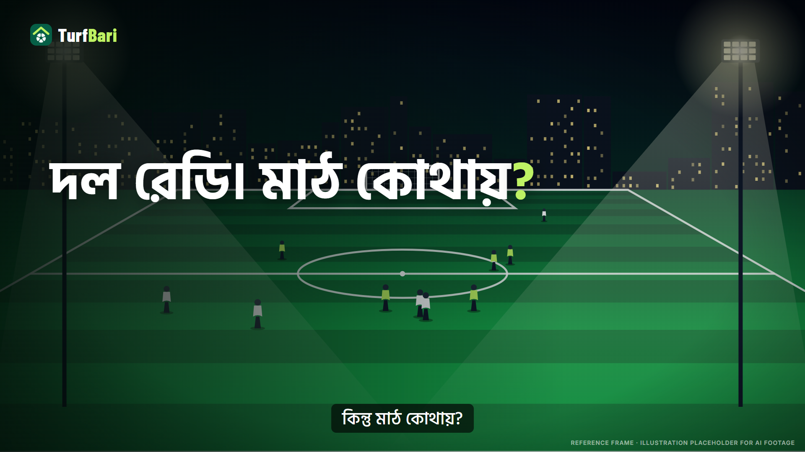

**s01-b** — খাতা • ফোনকল • বাকির হিসাব

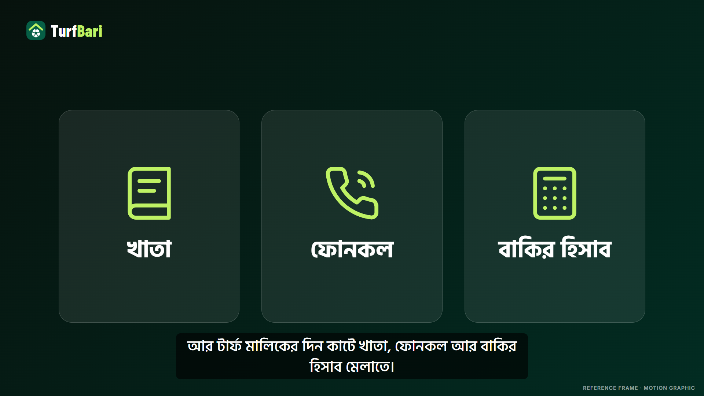

*Transition:* Whip-pan blur into a lime light-sweep that reveals the logo (Scene 2).  
*Audio:* Music starts with a filtered pulse (−18 dB), crowd ambience low; one bass hit on «মাঠ কোথায়?».

## 2. Introducing TurfBari — 0:20–0:38

**VO:** এই দুই দিকের ঝামেলা সহজ করতেই এসেছে টার্ফবাড়ি। খেলোয়াড়দের জন্য টার্ফ খোঁজা আর বুকিং রিকোয়েস্ট পাঠানো, আর মালিক ও ম্যানেজারদের জন্য পুরো টার্ফ ব্যবসা সামলানোর গোছানো ড্যাশবোর্ড—সব এক প্ল্যাটফর্মে। টার্ফবাড়ি—প্রতিটি টার্ফের ঠিকানা।

**s02-a** — প্রতিটি টার্ফের ঠিকানা

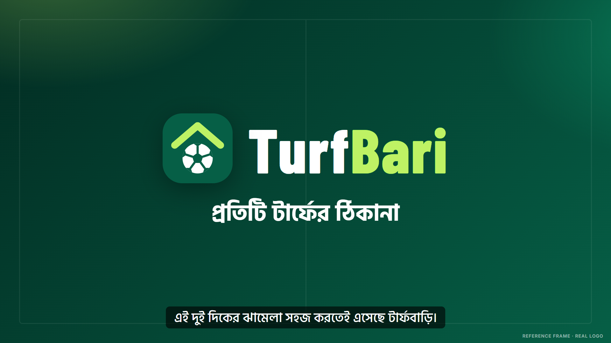

**s02-b** — খেলোয়াড় • মালিক • ম্যানেজার

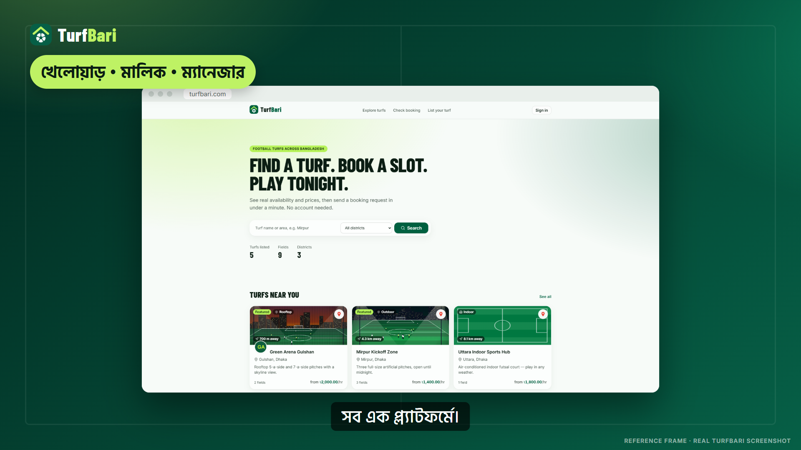

*Transition:* Zoom-through the search bar into the Explore page.  
*Audio:* Music opens up to full beat at the logo (−14 dB under VO). Logo whoosh + soft ball bounce SFX.

## 3. Public turf discovery — 0:38–1:08

**VO:** টার্ফবাড়ির ওয়েবসাইটে টার্ফ খুঁজতে কোনো অ্যাকাউন্ট লাগে না। লোকেশনের অনুমতি দিলেই আপনার সবচেয়ে কাছের টার্ফগুলো আগে দেখাবে, পাশে লেখা থাকবে কত দূরে। চাইলে জেলা আর এলাকা বেছে নিন, কিংবা টার্ফের নাম লিখে সার্চ করুন। প্রতিটি কার্ডে ছবি, ইনডোর না আউটডোর, কয়টি মাঠ আর ঘণ্টাপ্রতি শুরুর ভাড়া—একনজরেই। দশ জায়গায় ফোন করার দিন শেষ।

**s03-a** — কাছের টার্ফ আগে — দূরত্বসহ

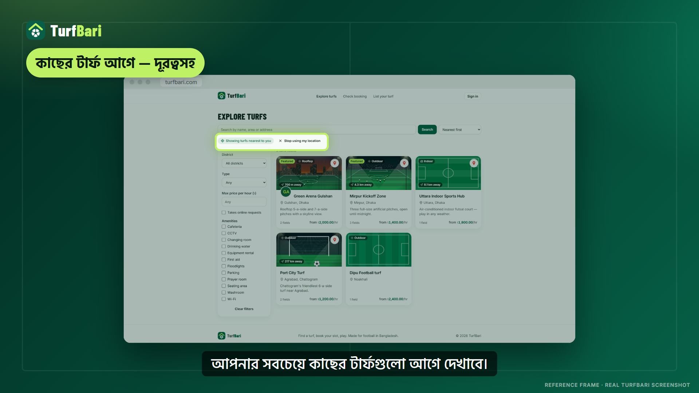

**s03-b** — জেলা • এলাকা • নাম দিয়ে সার্চ

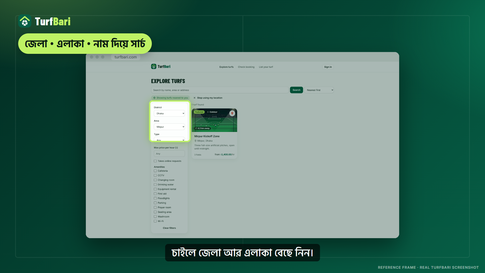

**s03-c** — অ্যাকাউন্ট ছাড়াই টার্ফ খুঁজুন

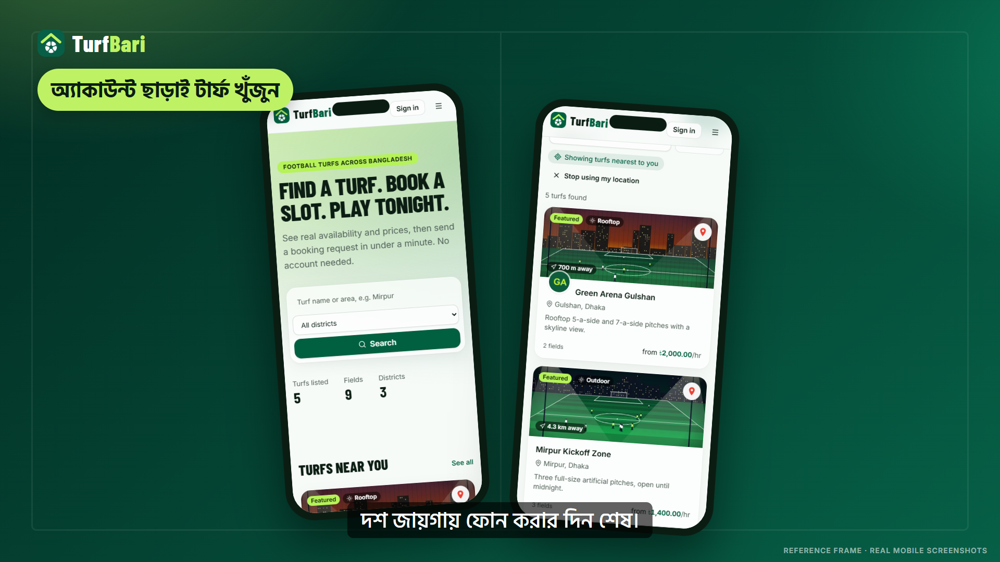

*Transition:* Card-expand: the Green Arena card scales up into its turf page.  
*Audio:* Soft UI clicks on each filter; light «tick» per card reveal (−24 dB).

## 4. Turf details and QR booking — 1:08–1:38

**VO:** পছন্দের টার্ফে ঢুকলেই দেখবেন ছবির গ্যালারি, সুবিধাগুলো, মাঠের তথ্য, খোলার সময় আর প্রতিটি স্লটের ভাড়া। ম্যাপে এক ট্যাপেই পেয়ে যাবেন পৌঁছানোর রাস্তা। প্রতিটি টার্ফের আছে নিজস্ব QR কোড—স্ক্যান করলেই খুলে যায় সেই টার্ফের বুকিং পেজ। তারিখ, মাঠ আর খালি সময় বেছে নিন, নাম আর মোবাইল নম্বর দিয়ে পাঠিয়ে দিন বুকিং রিকোয়েস্ট। টার্ফ কর্তৃপক্ষ কনফার্ম করলেই খেলা পাকা; রেফারেন্স নম্বর দিয়ে যেকোনো সময় স্ট্যাটাসও দেখে নিতে পারবেন।

**s04-a** — ছবি • সুবিধা • খোলার সময় • ভাড়া

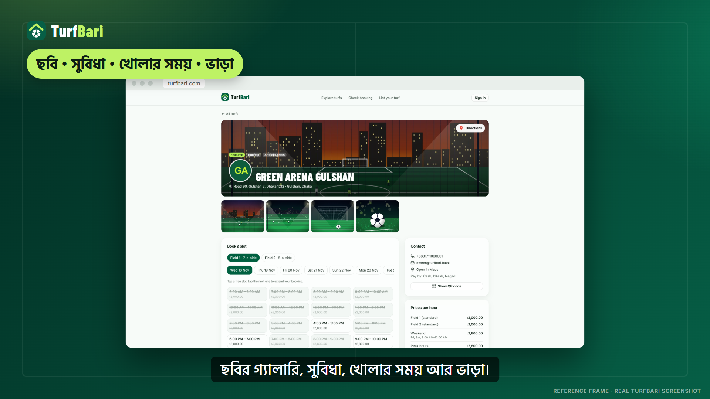

**s04-b** — প্রতিটি টার্ফের নিজস্ব QR কোড

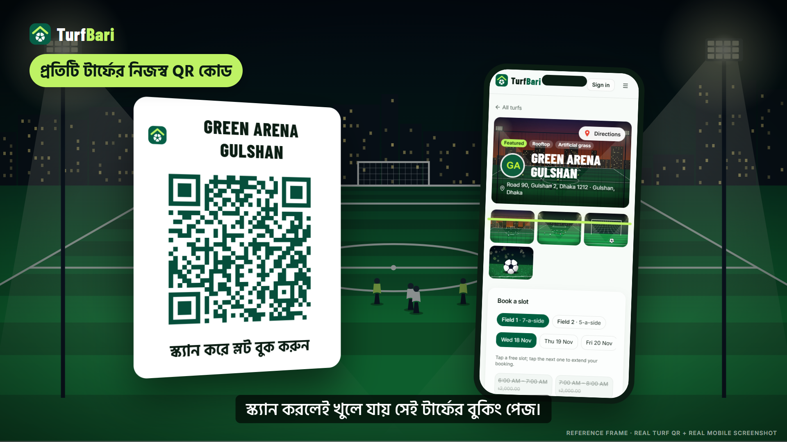

**s04-c** — তারিখ • মাঠ • খালি সময়

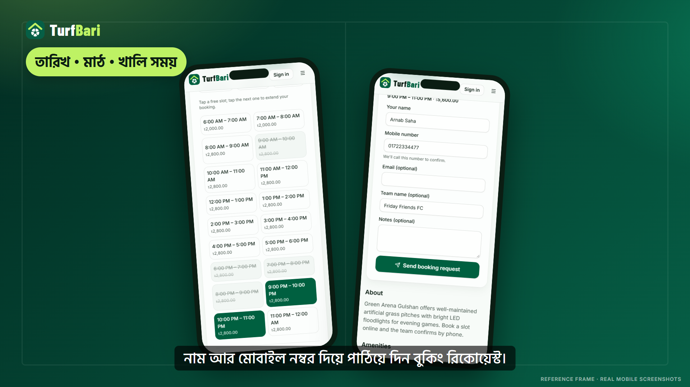

**s04-d** — রিকোয়েস্ট পাঠান → টার্ফ কনফার্ম করবে

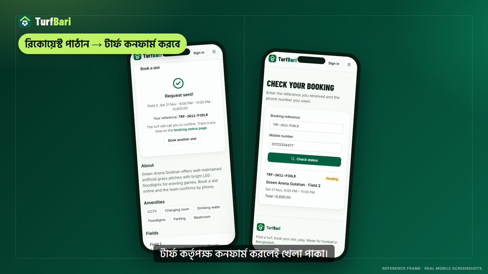

*Transition:* Match-cut: the «Pending» badge on the player's phone becomes the pending-requests banner on the owner dashboard.  
*Audio:* QR scan «bip» + short rising synth; tap sounds on slots; a gentle «ding» on Request sent.

## 5. Turf Owner Dashboard — 1:38–2:10

**VO:** এবার টার্ফ মালিকের পালা। ড্যাশবোর্ডে আজকের বুকিং, আজকের আদায়, এই মাসের আয় আর মোট বকেয়া—সব একনজরে। বুক আ স্লট বোর্ডে দেখুন কোন সময় খালি, কোনটা বুকড, আর কোন রিকোয়েস্ট কনফার্মের অপেক্ষায়। ফোনে কোনো দল বুকিং চাইলে কয়েক সেকেন্ডেই নিয়ে নিন—ডিসকাউন্ট আর অগ্রিম টাকাসহ। মাঠ, খোলার সময়, পিক আওয়ার আর উইকেন্ডের ভাড়া, কাস্টমারের বুকিং ইতিহাস—সবকিছু থাকে গোছানো, খাতা ছাড়াই।

**s05-a** — মালিকের ড্যাশবোর্ড

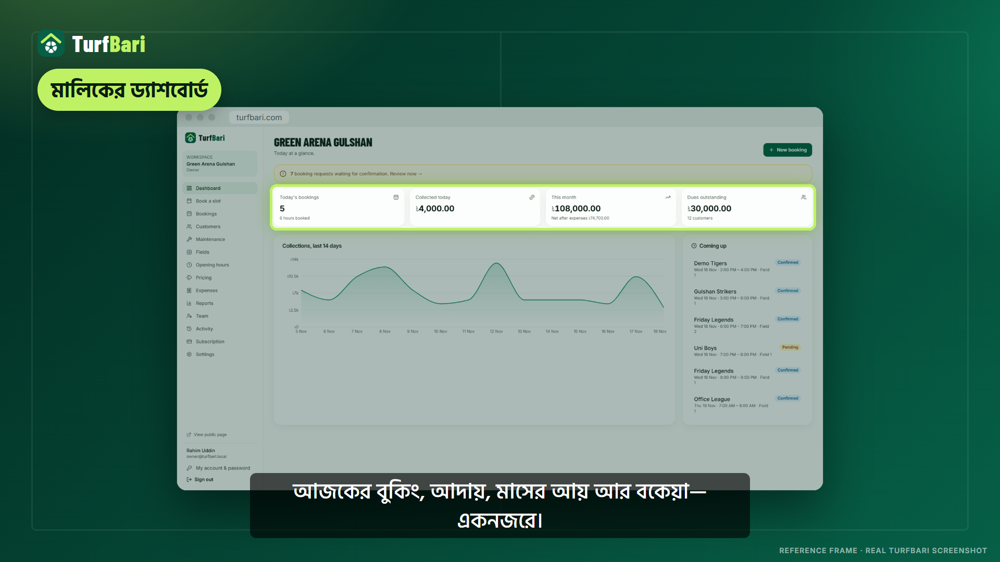

**s05-b** — এক বোর্ডে সব স্লট

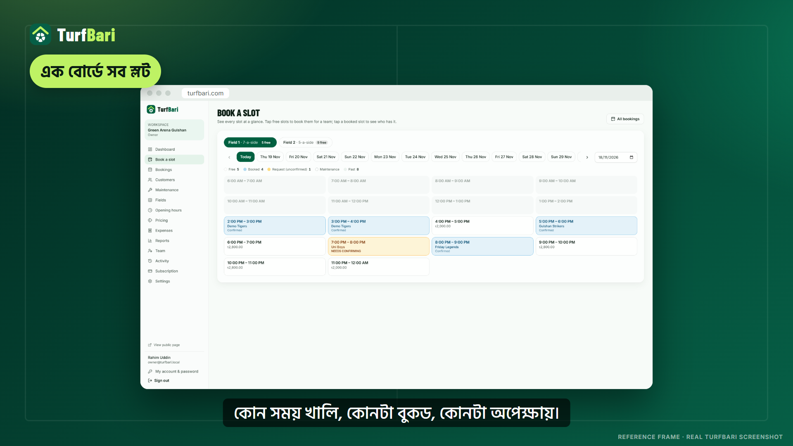

**s05-c** — ডিসকাউন্ট ও অগ্রিমসহ বুকিং

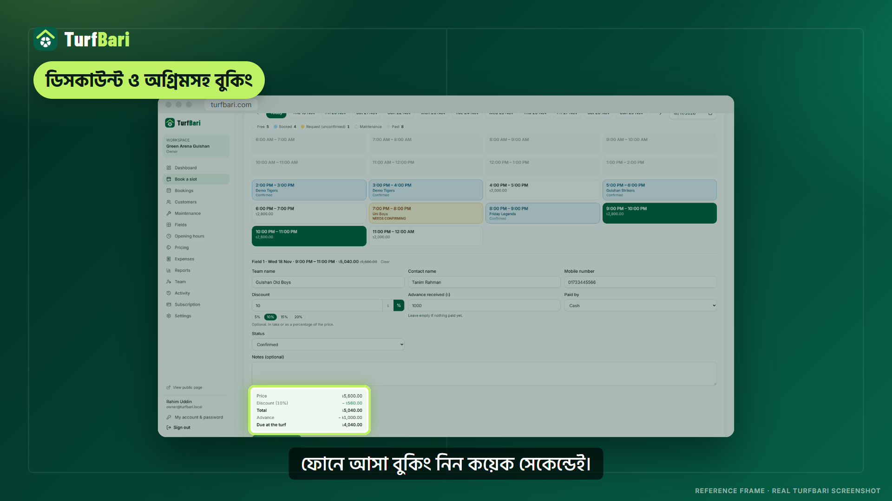

*Transition:* Slide the sidebar: the owner sidebar morphs into the shorter manager sidebar.  
*Audio:* Music steady; subtle keyboard/typing SFX under the booking form; click on the 10% chip.

## 6. Manager Dashboard — 2:10–2:35

**VO:** আর ম্যানেজার? মালিক টিম পেজ থেকে ম্যানেজার যুক্ত করলেই তিনি পান নিজের আলাদা লগইন। ম্যানেজার প্রতিদিনের বুকিং নেন, রিকোয়েস্ট কনফার্ম করেন, পেমেন্ট রেকর্ড করেন আর কাস্টমার সামলান। ভাড়া বদলানো, খরচ, রিপোর্ট আর টিম—এগুলো থাকে শুধু মালিকের হাতে। কাজ ভাগ হয়, নিয়ন্ত্রণ থাকে আপনার।

**s06-a** — ম্যানেজারের আলাদা লগইন

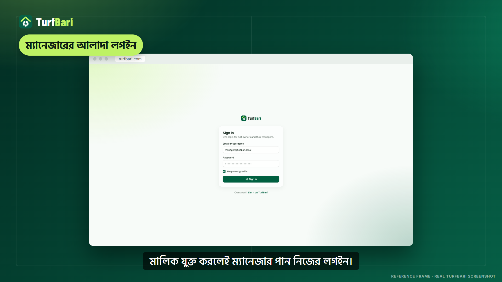

**s06-b** — বুকিং • কনফার্ম • পেমেন্ট • কাস্টমার

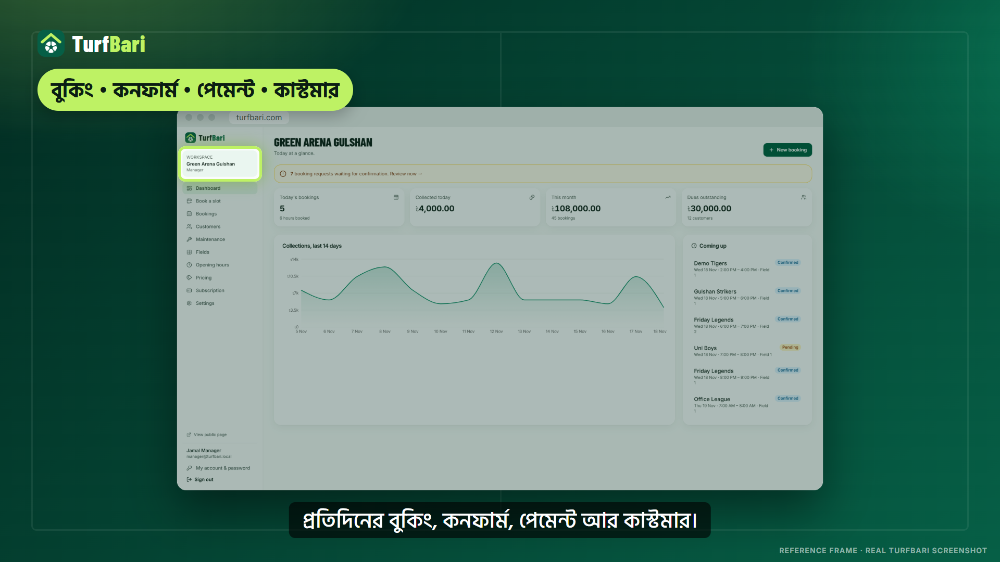

**s06-c** — ভাড়া, খরচ, রিপোর্ট — শুধু মালিকের হাতে

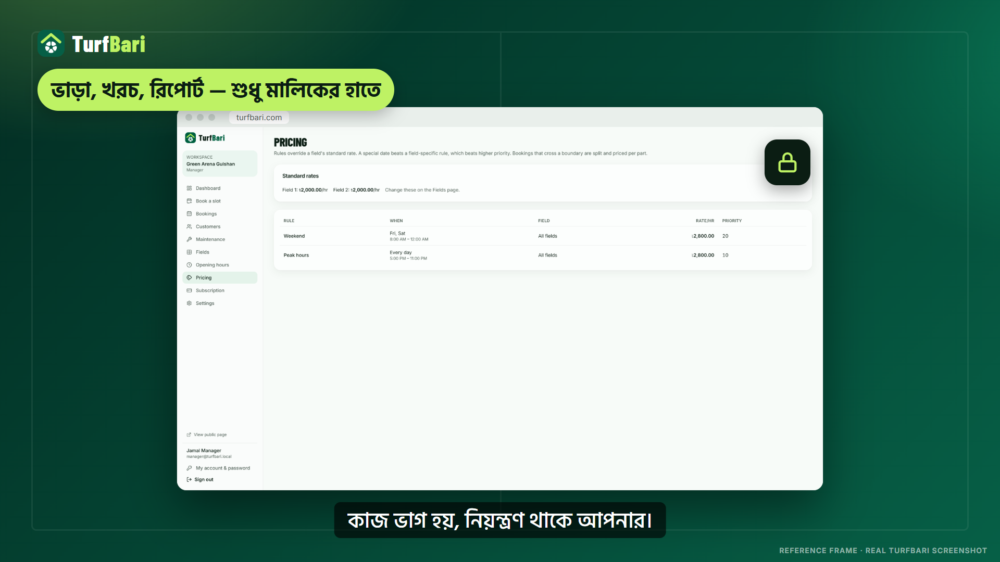

*Transition:* Push transition upward into the payments panel.  
*Audio:* Small «lock» click on the view-only shot. VO slightly warmer on «নিয়ন্ত্রণ থাকে আপনার».

## 7. Payments, reports and insights — 2:35–3:00

**VO:** প্রতিটি বুকিংয়ে দেখা যায় মোট ভাড়া, কত টাকা পরিশোধ হয়েছে আর কত বাকি। ক্যাশ, বিকাশ বা নগদ—যেভাবেই টাকা আসুক, রেকর্ড থাকে বুকিংয়ের সঙ্গেই। রিপোর্টে দেখুন আদায়, খরচ আর নিট আয়, দিনভিত্তিক আদায়ের চার্ট, আর কোন মাঠে কত বুকিং। দরকার হলে এক ক্লিকে এক্সেলে ডাউনলোড।

**s07-a** — পরিশোধ • বাকি • পেমেন্টের মাধ্যম

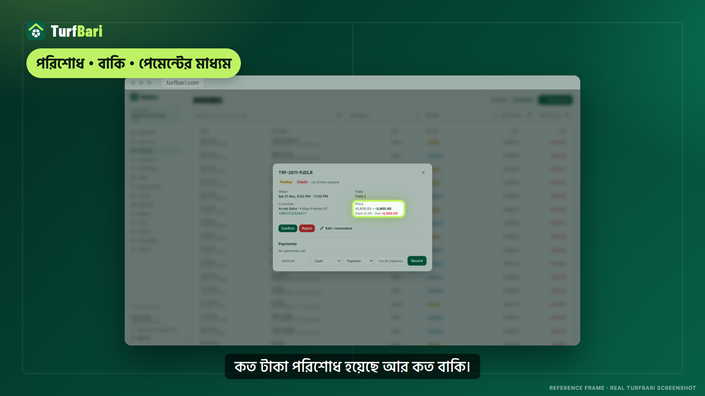

**s07-b** — আদায় • খরচ • নিট আয় • এক ক্লিকে এক্সেল

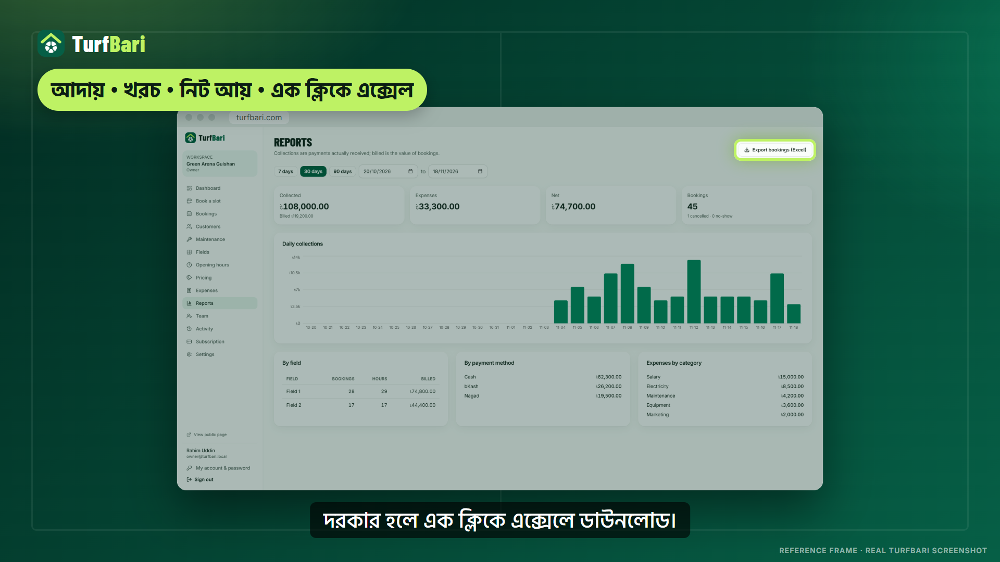

*Transition:* Pull back from the screen to a cinematic shot (VID-06 owner smiling at laptop).  
*Audio:* Cash-register «ka-ching» is too loud for this brand — use a soft coin chime (−22 dB). Paper-swoosh on the export.

## 8. The overall benefit — 3:00–3:18

**VO:** খেলোয়াড়দের জন্য সহজে টার্ফ খোঁজা আর ঝামেলাহীন বুকিং রিকোয়েস্ট। মালিকের জন্য গোছানো ব্যবসা আর পরিষ্কার হিসাব। ম্যানেজারের জন্য স্পষ্ট দায়িত্ব। মাঠের বাইরের ঝামেলা কমলে, মাঠের ভেতরের আনন্দটাই বাড়ে।

**s08-a** — 

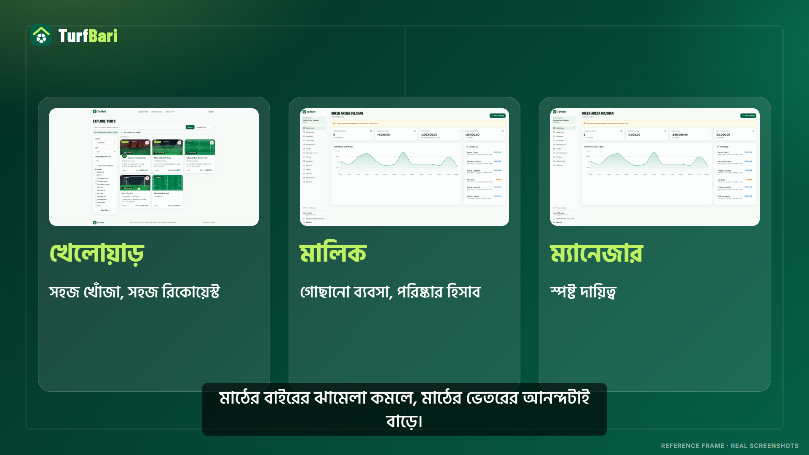

**s08-b** — খেলা হোক আরও সহজে

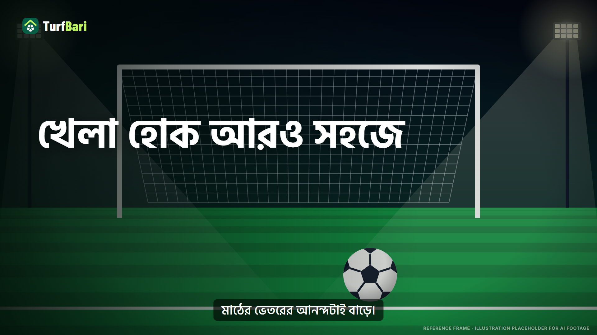

*Transition:* Flash to white-lime then cut to the brand background.  
*Audio:* Music builds; crowd cheer swells under the last line, then drops for the CTA.

## 9. Final branding and call to action — 3:18–3:35

**VO:** আপনি টার্ফ মালিক হলে, আজই আপনার টার্ফ যুক্ত করুন টার্ফবাড়িতে। আর খেলতে ভালোবাসলে, খুঁজে নিন আপনার পরের ম্যাচের মাঠ। টার্ফবাড়ি—প্রতিটি টার্ফের ঠিকানা। খেলা হোক আরও সহজে।

**s09-a** — আপনার টার্ফ যুক্ত করুন

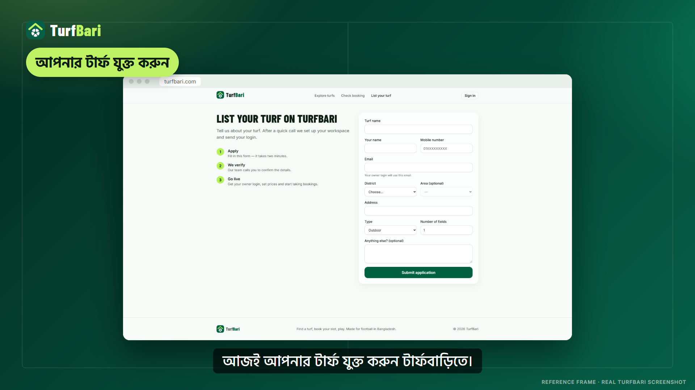

**s09-b** — প্রতিটি টার্ফের ঠিকানা

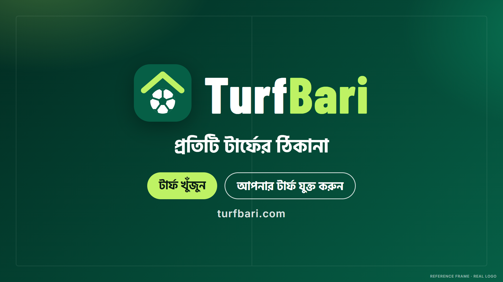

*Transition:* Fade to black (1 s).  
*Audio:* Music resolves on the tagline; final logo sting (single bass + shimmer). Silence for the last 0.5 s.
